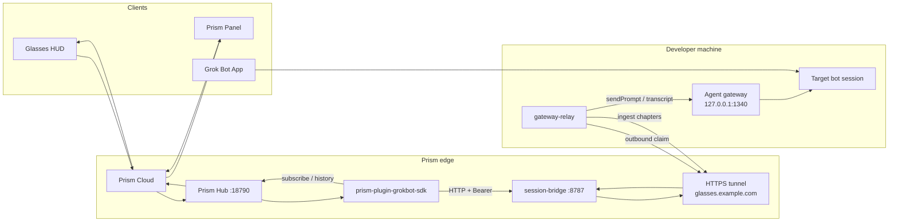

# Architecture

## End-to-end

## Component roles

| Component | Where it runs | Role |
|-----------|---------------|------|
| Prism Panel / glasses | Phone / Glasses | UI; shared sessions; glasses = paged HUD |
| Prism Cloud | Rokid | Account, devices, remote Hub session |
| Prism Hub | Hub host `:18790` | Starts plugin, PluginBridge transport |
| prism-plugin-grokbot-sdk | Same host as Hub | list/attach/send/subscribe/history; novel-style pages |
| session-bridge | Same host `:8787` | Sessions/chapters; `DELIVERY_MODE=gateway` queue; `/v1/ingest`; optional webhook |
| HTTPS tunnel | You provide | Public URL → `127.0.0.1:8787` (do not expose 8787/18790/1340 raw) |
| gateway-relay | Developer machine only | Claim jobs → `sendPrompt`; transcript → ingest labels |
| Agent gateway | Loopback `:1340` | Non-public API — never map to the internet |

## Bidirectional flows

### A. Glasses / Panel → App

1. User picks a bot and sends a message in Panel/glasses.
2. Hub → plugin → `POST /v1/command` (may include `target_bot_id`).
3. Bridge enqueues a gateway job (`awaiting_reply`).
4. Relay long-polls `/v1/gateway/claim`.
5. Relay calls local `sendPrompt` (records glasses nonces).
6. Relay polls transcript; collects assistant replies.
7. `POST /v1/ingest` (or signed `reply_url`) writes chapters; session completes.
8. Plugin subscribe / waitForRun pushes paged assistant events back to Hub → Panel/glasses.

If the user types in the App while glasses are waiting, the relay can mark takeover and finish the glasses wait early; App traffic still syncs under computer labels.

### B. App → Panel / glasses

1. User chats in the Grok Bot App.
2. Relay uses `/v1/gateway/bindings` (`agent_id ↔ session_id`) and polls transcript.
3. User entries that are **not** glasses nonces → ingest with chapter title **`电脑`** (computer).
4. Matching bot replies → ingest with **`电脑续聊`** (computer follow-up).
5. Plugin rebuilds turns from chapters; Panel shows labeled rounds.

## Ports (defaults)

| Port | Service | Notes |
|------|---------|-------|
| 18790 | Prism Hub | Loopback on hub host |
| 8787 | session-bridge | Loopback; publish only via tunnel |
| 1340 | Agent gateway | Loopback on developer machine only |

## Delivery modes

- `gateway` (recommended): enqueue for relay; optional webhook fallback after `GATEWAY_FALLBACK_MS`.
- `webhook`: POST to Routine / inbound URL directly.
- `both`: enqueue and webhook.

## Labels

Chapter titles `电脑` / `电脑续聊` are product UX strings in the plugin/relay path. Keep them stable unless you intentionally change the HUD copy.
